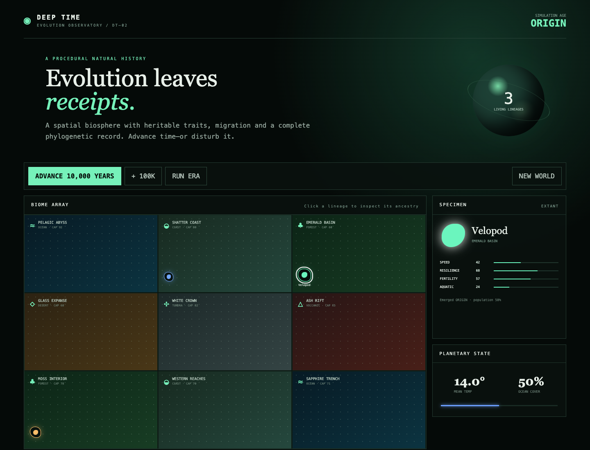

# Deep Time

**A procedural evolution observatory where tiny interventions reshape a million years of natural history.**

Deep Time is an experimental browser simulation: advance a synthetic planet through geological eras, watch lineages adapt, split and disappear, then leave one rare intervention in the event record. The same seed and intervention sequence produce the same history, making worlds reproducible.

[](https://github.com/ScDomi/deep-time/actions)
[](LICENSE)



The screenshot above is captured from the current DT-02 application running locally. This repository intentionally does not claim a hosted live deployment; reviewers can reproduce the same browser application with the steps below.

## Current features — DT-02

- Deterministic seeded simulation with per-stratum RNG
- Nine spatial biomes with different climates and carrying capacities
- Habitat fitness, crowding and migration between neighboring regions
- Four heritable traits (`speed`, `resilience`, `fertility`, `aquatic`)
- Procedural speciation, extinction and persistent parent-child ancestry
- Interactive phylogenetic record and specimen inspector
- Meteor, oxygen and sea-level interventions
- Simulation event timeline (the current UI labels this panel `FOSSIL RECORD`; geological fossils and strata are planned for DT-03)
- Zero backend and zero personal-data collection

## Requirements

- Node.js 22 or newer
- npm 10 or newer

The current verification was run with Node.js 26.8.1 and npm 11.19.0. CI uses Node.js 22, which is the minimum supported runtime.

## Run locally

```bash
git clone https://github.com/ScDomi/deep-time.git
cd deep-time
npm ci
npm run dev
```

Vite prints the local URL after startup. Open the `/deep-time/` route when it is not opened automatically; with the default Vite port this is normally:

```text
http://localhost:5173/deep-time/
```

No environment variables, API keys, backend services or external datasets are required.

## Verify the repository

Run the same checks used by GitHub Actions:

```bash
npm run typecheck
npm test
npm run build
```

Expected current baseline:

- TypeScript project check succeeds.
- Vitest reports 1 test file and 6 passing tests.
- Vite creates the production bundle in `dist/`.

For dependency security metadata:

```bash
npm audit
```

## Next milestone — DT-03: Geological Memory

DT-03 is planned work and is **not implemented in the current application**. The milestone is intended to add a reconstructable geological past:

- **Plate tectonics** — continents drift, mountain ranges form, rifts open new habitats
- **Geological layers** — sedimentation and erosion build a datable stratigraphic column
- **Fossilisation** — probabilistic preservation of extinct species in strata
- **Palaeontology Mode** — excavate layers and inspect uncertain evidence
- **Known vs. true record** — explicit separation between simulation ground truth and what a scientist could reconstruct

All 12 implementation issues remain open in the [DT-03 milestone](https://github.com/ScDomi/deep-time/milestone/1). Their shared ownership, determinism, age-uncertainty and erosion contracts are documented in [the DT-03 implementation contract](docs/DT-03-SPECIFICATION.md).

Planned dependency path:

```text
#1 data model → #2/#3 → #4 → #5/#6/#9 → #7
#1/#3 → #10
#1–#4 + #10 → #11 → #12
#8 seed sharing can be developed independently
```

## Architecture

Simulation logic lives in `src/simulation.ts` as pure functions — `createWorld`, `advance`, `intervene`, `lineagePath` — with no React dependency. The UI in `src/App.tsx` holds application state and calls those functions. This separation makes the engine independently testable and leaves room for future headless runs.

The Vite base path remains `/deep-time/` so local production previews and repository-relative builds resolve assets consistently. There is currently no deployment workflow.

## Reproducibility

The current DT-02 application starts with seed `731991`. Engine tests verify deterministic world creation and chunk parity: advancing a world by multiple steps in one call produces the same result as advancing it one step at a time.

The DT-03 milestone will extend this contract to geological records. It must not use wall-clock time, `Math.random()` or UI state as simulation entropy; see the implementation contract for the complete planned rules.

## Contributing

The `dt-03` label marks Geological Memory work. Keep one issue per pull request, preserve the existing deterministic tests and implement only the acceptance criteria of the selected issue. See [CONTRIBUTING.md](CONTRIBUTING.md).

## License

MIT — build strange worlds with it.
